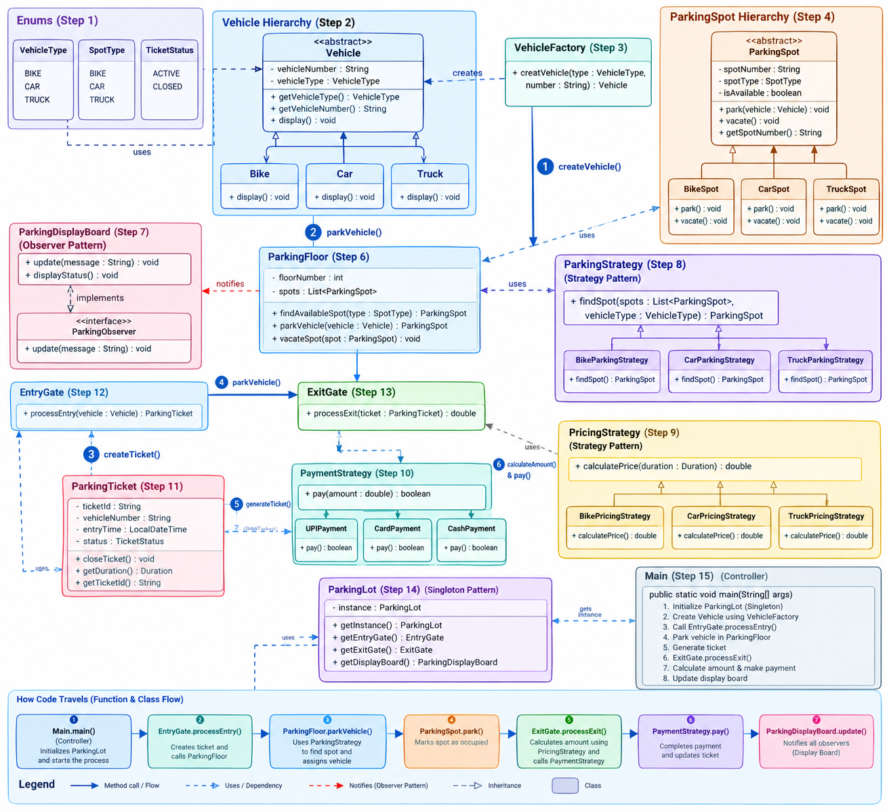

# 🚗 ParkEngine

**An extensible, Java-based vehicle parking engine built to demonstrate Low-Level Design (LLD), modular architecture, and design patterns.**

ParkEngine models a multi-floor parking facility with vehicle-specific spots, automated allocation, ticket management, configurable pricing, payment options, and live availability notifications. Its focus is the **architecture behind the workflow**, rather than a CRUD interface.

## 🏗️ Architecture

> **Diagram note:** This is a conceptual UML overview. Some names, method signatures, and strategy subclasses shown in the diagram differ from the current Java source. Refer to the source for the exact implementation.

### Main components

| Component | Responsibility |
|---|---|
| `Parkinglot` | Central coordinator; manages floors, strategies, and active tickets |
| `ParkingFloor` | Holds parking spots, locates available spots, and notifies observers |
| `ParkingSpot` | Base class for bike, car, and truck parking spots |
| `Vehicle` / `VehicleFactory` | Vehicle hierarchy and centralized object creation |
| `Entrygate` / `ExitGate` | Ticket creation, exit processing, and billing |
| `ParkingTicket` | Tracks the vehicle, allocated spot, timestamps, and ticket status |
| `ParkingStrategy` | Selects a compatible available spot |
| `PricingStrategy` | Calculates charges according to the selected pricing policy |
| `PayementStrategy` | Selects the simulated payment method |
| `ParkingObserver` | Receives availability updates; implemented by the display board |

## 🧩 Design patterns

The current implementation demonstrates **four distinct design-pattern types**, with Strategy applied in three separate areas:

| Pattern | Implementation | Purpose |
|---|---|---|
| **Factory** | `VehicleFactory` | Centralizes creation of bike, car, and truck objects |
| **Strategy** | `ParkingStrategy`, `PricingStrategy`, `PayementStrategy` | Keeps allocation, pricing, and payment behavior interchangeable |
| **Observer** | `ParkingFloor` → `ParkingObserver` → `Parkingdisplayboard` | Updates registered display boards when spot occupancy changes |
| **Singleton** | `Parkinglot` | Provides one central parking-lot instance |

`ParkingTicket` currently uses a parameterized constructor, **not a Builder implementation**.

## ✨ Features

- Multi-floor parking with separate bike, car, and truck spots
- First-available compatible spot allocation
- Duplicate active-vehicle checks and ticket-based vehicle exit
- Ticket generation, active-ticket lookup, and vehicle-number search
- Time-based charges with normal and weekend pricing strategies
- Simulated cash, UPI, and card payments
- Observer-driven availability updates after parking and spot release
- Swappable parking and pricing policies through interfaces

## 🔄 System workflow

### Vehicle entry

1. `VehicleFactory` creates a vehicle from its type and registration number.
2. `Parkinglot` checks whether the vehicle is already registered as parked.
3. `ParkingStrategy` selects an available compatible spot across floors.
4. The selected `ParkingFloor` occupies the spot and notifies observers.
5. `Entrygate` creates a `ParkingTicket`, which is indexed by ticket and vehicle number.

### Vehicle exit

1. `Parkinglot` retrieves the active ticket by ticket number.
2. `ExitGate` closes the ticket and calculates parking duration and charges.
3. The selected `PayementStrategy` simulates payment.
4. The spot is released, observers are notified, and the active ticket is removed.

**Important:** Payment methods currently print success messages; they are not connected to real payment gateways.

## 🧠 Data structures and design

- `List<ParkingFloor>` stores the floors in the parking lot.
- Each floor uses `List<ParkingSpot>` and `List<ParkingObserver>`.
- `Map<Integer, ParkingTicket>` indexes active tickets by ticket number.
- `Map<String, ParkingTicket>` indexes active tickets by vehicle number.
- Abstract vehicle and parking-spot hierarchies encapsulate vehicle-specific compatibility behavior.

This separation keeps core responsibilities in focused classes and makes it possible to add new strategy or observer implementations without rewriting the central workflow. Adding new vehicle types also requires updating the corresponding enums, spot hierarchy, and factory.

## 🛠️ Tech stack

**Java · Low-Level Design · Object-Oriented Design · Java Collections · Design Patterns · `java.time`**

The application is currently a console-based, in-memory implementation; it does not require a database or external dependencies.

## ▶️ Run locally

Requirements: a Java Development Kit (JDK).

Place `program1017.java` in your project folder, then run:

~~~bash
javac program1017.java
java program1017
~~~

The console menu supports parking a vehicle, exiting a vehicle, searching by vehicle number, displaying the parking lot, and quitting.

## 📁 Repository layout

~~~text
ParkEngine/
├── program1017.java    # Java source
├── UML.png             # Architecture diagram
└── README.md           # Project documentation
~~~

## 🔍 Current scope and future improvements

ParkEngine is an **LLD learning project**, not a production-ready parking service. Its state is held in memory, its payment methods are simulations, and the current implementation has areas to harden before deployment—including the vehicle-number map cleanup on exit, input validation, and concurrent parking operations.

Possible next steps include automated tests, stronger transaction handling, database persistence, REST APIs, additional allocation/pricing strategies, and a web dashboard.

## 👨‍💻 Author

**Maanas Brahme**  
Java · Low-Level Design · Software Development
